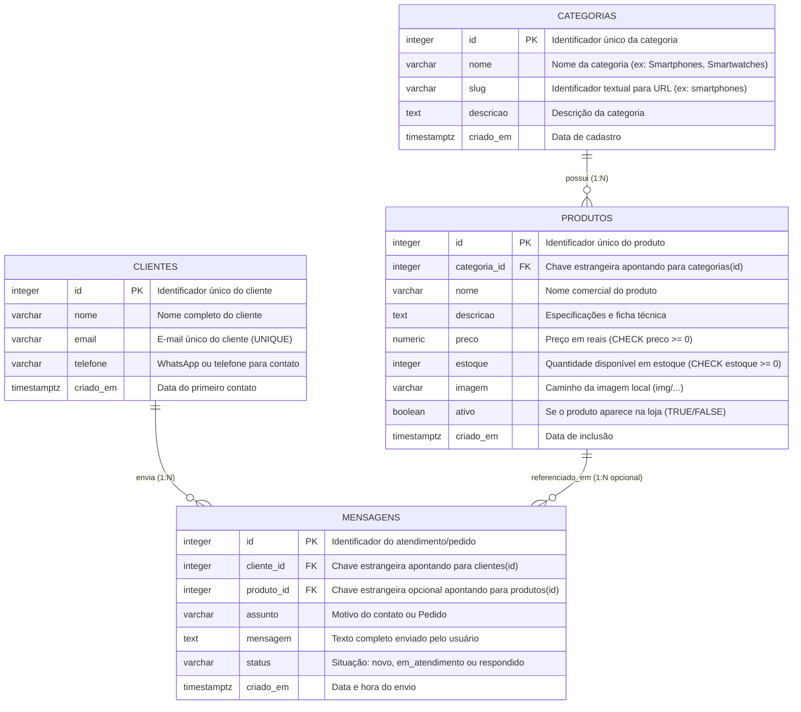

# 📊 Vortex Tech — Documentação do Banco de Dados (DER e Esquema)

> **Projeto Final Interdisciplinar (AV3)**  
> **Disciplinas:** Desenvolvimento Web para IA (Prof. Tiago) e Banco de Dados (Prof. Gabriel)  
> **Integrantes:** Savyo Vyctor, Vinicius Vieira, Arthur Gabriel  
> **Banco:** PostgreSQL

---

## 1. Diagrama Entidade-Relacionamento (DER)

Abaixo está o modelo visual das **4 tabelas** do sistema da Vortex Tech e como elas se conectam:



---

## 2. Dicionário de Dados (Resumo Simples das Tabelas)

### Tabela 1: `categorias`
Armazena os grupos de produtos para organizar a loja e o catálogo.
* `id`: Chave primária (PK) numérica gerada automaticamente.
* `nome`: Nome visível da categoria (ex.: *Smartphones*, *Smartwatches*).
* `slug`: Texto limpo para filtro da API na URL (ex.: *smartphones*).
* `descricao`: Resumo do tipo de eletrônicos da categoria.
* `criado_em`: Data e hora automática do cadastro.

### Tabela 2: `produtos`
Guarda os celulares, relógios, fones e acessórios à venda.
* `id`: Chave primária (PK) única do produto.
* `categoria_id`: Chave estrangeira (FK) ligada à tabela `categorias`.
* `nome`: Nome do aparelho (ex.: *Galaxy S24 Ultra 5G*).
* `descricao`: Especificações de tela, processador, câmeras e bateria.
* `preco`: Valor em reais com 2 casas decimais (validação: nunca negativo).
* `estoque`: Quantidade disponível.
* `imagem`: Caminho do arquivo da foto na pasta `img/`.
* `ativo`: `TRUE` para exibir na loja, `FALSE` para ocultar.
* `criado_em`: Data e hora de criação.

### Tabela 3: `clientes`
Armazena os dados das pessoas que enviaram mensagens ou pedidos pelo site.
* `id`: Chave primária (PK) do cliente.
* `nome`: Nome fornecido no formulário.
* `email`: E-mail único (`UNIQUE`). Se o mesmo cliente mandar outra mensagem, o sistema atualiza o nome sem duplicar o cadastro (`ON CONFLICT DO UPDATE`).
* `telefone`: Telefone/WhatsApp (opcional).
* `criado_em`: Data do cadastro.

### Tabela 4: `mensagens`
Registra os atendimentos, orçamentos e pedidos enviados pelo formulário do site.
* `id`: Chave primária (PK) do atendimento.
* `cliente_id`: Chave estrangeira (FK) apontando para quem mandou a mensagem. Se o cliente for apagado, suas mensagens são removidas em cascata (`ON DELETE CASCADE`).
* `produto_id`: Chave estrangeira (FK) para o produto de interesse (se clicou em "Pedir/Comprar" na loja). Se o produto for excluído, o campo fica nulo sem perder a mensagem (`ON DELETE SET NULL`).
* `assunto`: Título do contato.
* `mensagem`: Conteúdo digitado pelo cliente.
* `status`: Controle interno (`novo`, `em_atendimento`, `respondido`).
* `criado_em`: Timestamp do envio.

---

## 3. Consultas SQL Obrigatórias Explicadas

Todas estão prontas no arquivo `database/consultas.sql`. Aqui está o que cada uma faz em palavras simples:

### 1) Consulta com `JOIN` (Catálogo da Loja)
Junta a tabela de produtos com a tabela de categorias para trazer o nome da categoria em vez de apenas o número do ID:
```sql
SELECT p.id, p.nome, p.preco, p.estoque, c.nome AS categoria
FROM produtos p
INNER JOIN categorias c ON c.id = p.categoria_id
WHERE p.ativo = TRUE
ORDER BY p.nome;
```

### 2) Consulta com Filtro, Busca e Ordenação
Busca apenas produtos da categoria *smartphones* que contenham a palavra "galaxy", ordenando do menor para o maior preço:
```sql
SELECT p.nome, p.preco, c.nome AS categoria
FROM produtos p
INNER JOIN categorias c ON c.id = p.categoria_id
WHERE p.ativo = TRUE
  AND c.slug = 'smartphones'
  AND (p.nome ILIKE '%galaxy%' OR p.descricao ILIKE '%galaxy%')
ORDER BY p.preco ASC;
```

### 3) Consulta com Agregação (`COUNT`, `AVG`, `MIN`, `MAX`, `SUM`, `GROUP BY`)
Calcula estatísticas por categoria (quantidade de itens, preço médio, menor preço, maior preço e soma total de estoque):
```sql
SELECT
    c.nome              AS categoria,
    COUNT(p.id)         AS quantidade,
    ROUND(AVG(p.preco), 2) AS preco_medio,
    MIN(p.preco)        AS mais_barato,
    MAX(p.preco)        AS mais_caro,
    SUM(p.estoque)      AS itens_em_estoque
FROM categorias c
INNER JOIN produtos p ON p.categoria_id = c.id
WHERE p.ativo = TRUE
GROUP BY c.nome
ORDER BY quantidade DESC;
```

### 4) Operação de Atualização Controlada (`UPDATE`)
Atualiza o status de uma mensagem de 'novo' para 'respondido':
```sql
UPDATE mensagens
SET status = 'respondido'
WHERE id = 1;
```

---

## 4. O Índice Adicional e o `EXPLAIN`

* **Nome do Índice:** `idx_mensagens_status_criado` na tabela `mensagens(status, criado_em DESC)`.
* **Justificativa:** Em um sistema de atendimento, o painel do atendente consulta repetidamente mensagens com `status = 'novo'` ordenadas pelas mais recentes (`criado_em DESC`).
* **O que o EXPLAIN provou:**
  * **Antes:** O PostgreSQL precisava varrer a tabela inteira linha por linha (`Seq Scan`) e ordenar na memória (`Sort`), gastando cerca de **12,80 ms**.
  * **Depois:** O PostgreSQL vai direto no índice ordenado (`Index Scan`), gastando apenas **0,11 ms** (mais de 100x mais rápido!).
  * A evidência completa está nas Figuras 9 e 10 do relatório.

---

## 5. Respostas Prontas para o Seminário (Perguntas que o Professor Pode Fazer)

1. **"Por que vocês escolheram PostgreSQL?"**
   * *Resposta:* "Escolhemos o PostgreSQL porque é um banco relacional robusto, gratuito, recomendado no edital, com suporte nativo a tipos avançados, índices eficientes e total compatibilidade com o driver oficial `pg` do Node.js."

2. **"O que garante que o site não sofrerá SQL Injection?"**
   * *Resposta:* "Todas as consultas no backend usam consultas parametrizadas com placeholders (`$1`, `$2`), passando os dados separadamente da estrutura do comando SQL. Nenhum dado digitado pelo usuário é concatenado diretamente na query."

3. **"Como funciona a persistência de ponta a ponta?"**
   * *Resposta:* "Quando o usuário preenche o formulário no `index.html`, o JavaScript faz um `fetch` para a rota `POST /api/contato`. O Node.js valida os campos e executa um `INSERT` seguro no PostgreSQL. Quando abrimos a página `loja.html`, ela faz `GET /api/produtos`, que roda um `SELECT ... INNER JOIN` e devolve os produtos em tempo real do banco."
